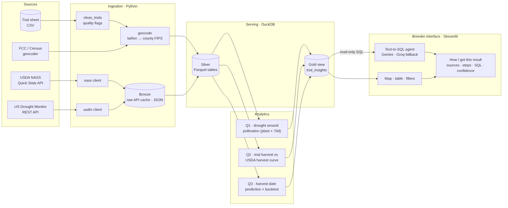

# GDM Corn Trials: Breeder Copilot

[](https://github.com/luandemitry/GMD-business-case/actions/workflows/ci.yml)

Combines GDM corn field-trial data with USDA NASS harvest progress and the U.S. Drought Monitor, and gives breeders a map, a trial-by-trial explanation and a chat that answers questions in plain language. Every answer shows **how it was obtained**: sources, steps, the SQL that ran, assumptions and a confidence level.

**Live app:** https://gdm-breeder-copilot.streamlit.app (password shared with the evaluation team)

> The trial sheet is confidential and is **not** in this repository. Results below are aggregates; the trial-level answers were sent separately.

---

## 1. Answers to the business questions

Season 2026, data as of October 31, 2026. 40 rows in the sheet → 39 trials after cleaning, 35 inside the US.

| Question | Answer |
|---|---|
| **Which trials had drought around pollination?** | **10 of 35** US trials: 4 with severe drought (≥50% of the county in D2+), 6 with drought (D1+). Another 9 were abnormally dry (D0) and 16 had no drought. The 4 trials outside the US have no Drought Monitor coverage. |
| **How does harvest at our trials compare with USDA?** | Of the 26 harvested trials, **13 were harvested early** (state < 25% harvested) and **13 at a typical time** (25–75%); none late. Median: trials are harvested when the state is **26%** harvested (half of them between 17% and 44%). All 35 US trials had a state-level NASS series; the national fallback was never needed. |
| **When will unharvested trials be ready?** | All **13 trials without a harvest date** are predicted ready by now: 10 are more than two weeks past the expected date (**likely harvested but not recorded**) and 3 are ready now. The method has a **5.3-day average error** in a leave-one-out backtest. |

In the app, the chat answers these and follow-up questions ("which of those are in Iowa?") with the list of trials.

---

## 2. Architecture



| Layer | Prototype | Why |
|---|---|---|
| Ingestion | Python clients with retries and an on-disk cache of raw responses | Re-runs never re-call an API; raw payloads are kept for audit |
| Storage | Parquet + DuckDB (`data/breeder.duckdb`) | Typed dates, columnar, single file, read-only mode for the agent |
| Serving | View `trial_insights`: one row per trial with the three answers | One curated table for the UI and the agent |
| Interface | Streamlit (map, trial explanation, chat) on Streamlit Community Cloud | Free, fast to ship, enough for a prototype |
| LLM | Gemini 3.6 Flash, Groq fallback, behind a small interface | Zero cost; provider swap is configuration only |
| Automation | GitHub Actions: unit tests, live API tests, manual pipeline run | Validates the real APIs on every push |

Production target (Azure) in [docs/production.md](docs/production.md), diagram in [docs/production.png](docs/production.png).

### Pipeline

```
trial sheet ─► clean_trials ─► geocode (FCC) ─┐
USDA NASS ─────────────────────────────────────┼─► drought / harvest / predict ─► DuckDB ─► app + agent
Drought Monitor (per county) ──────────────────┘
```

| Step | Module | Output |
|---|---|---|
| Clean the sheet, flag every issue | `src/clean_trials.py` | `trials` with `dq_flags` |
| Coordinates → county FIPS and state | `src/geocode.py` (FCC Area API, no key) | `county_fips`, `state_code`, `is_us` |
| Weekly % of corn harvested, per state and national | `src/nass.py` (NASS Quick Stats) | `usda_harvest_progress` |
| Weekly % of county area in D0–D4 | `src/usdm.py` (USDM REST service, no key) | `usdm_weekly` |
| Q1 drought at pollination | `src/drought.py` | `drought_pollination` |
| Q2 harvest vs USDA | `src/harvest.py` | `harvest_comparison` |
| Q3 prediction + backtest | `src/predict.py` | `harvest_prediction`, `harvest_backtest` |
| Orchestration and database | `src/pipeline.py` | `data/breeder.duckdb` |

---

## 3. Methodology and assumptions

### Q1. Drought around pollination
- Pollination = **planting + 70 days** (given by the case), window **±7 days** around it.
- For each trial, take the U.S. Drought Monitor weeks of its **county** that overlap the window, using *traditional* (cumulative) statistics: D1 = % of the county in D1 or worse.
- Peak over those weeks; classification: **severe drought** if ≥50% of the county is in D2+, **drought** if ≥50% in D1+, **abnormally dry** if ≥50% in D0+, otherwise **no drought**.

### Q2. Harvest vs USDA
- NASS weekly `PCT HARVESTED` for corn for grain (silage excluded), state level, linearly interpolated between weekly reports; 0% before the first report.
- For each harvested trial: % of its state harvested on the trial's harvest date, and days before/after the state reached 50%.
- Labels: **early** < 25%, **typical** 25–75%, **late** > 75%.
- States without a weekly NASS series fall back to the national curve (flagged). Not needed this season.

### Q3. Harvest prediction
Two independent estimates, averaged:
- **A. Maturity-zone cycle:** planting + median days from planting to harvest of harvested trials in the same zone (needs ≥2 trials, otherwise all trials).
- **B. USDA curve:** date the trial's state reaches the % harvested at which harvested trials of the same zone were harvested. Trials harvested before the area started (<5%) are excluded from this target because 0% carries no timing information.
- **Confidence** from agreement: high (≤10 days apart), medium (≤25), low (otherwise or only one method).
- **Status:** `overdue_verify_record` (expected >14 days ago), `ready_now`, `upcoming`.

| Assumption | Value | Where |
|---|---|---|
| Pollination offset | 70 days | `src/drought.py` |
| Pollination window | ±7 days | `src/drought.py` |
| Drought area threshold | 50% of county | `src/drought.py` |
| Early / late harvest | <25% / >75% of state harvested | `src/harvest.py` |
| NASS season start | July 1 (earlier weeks dropped) | `src/nass.py` |
| Min. trials per zone | 2 | `src/predict.py` |

### Validation: backtest
Leave-one-out on the 26 harvested trials: each one is hidden, predicted with the others, and compared with its real date.

| Method | Mean absolute error | Bias |
|---|---|---|
| A. Maturity-zone cycle | 7.3 days | 0.0 |
| B. USDA curve | 6.4 days | +0.4 |
| **Combined (used)** | **5.3 days** | **+0.2** |

The first backtest showed a 50-day error for method B. Breaking the error down by state isolated **North Dakota (−285 days)**: the NASS series contained out-of-season weeks (spring reports) that made the curve look complete in April. Dropping weeks before July 1 fixed it. One Missouri trial still misses by 34 days; with a single trial it is reported, not tuned.

---

## 4. Data quality findings

The case warned the data was not clean. Nothing is dropped silently: every issue becomes a flag on the row, shown in the app and used by the agent to lower confidence.

| Finding | Rows | Handling |
|---|---|---|
| Exact duplicate row | 1 | Removed |
| Maturity zone 0 (legend is 1–10) | 5 | Flagged; zone-based estimates use all trials |
| Coordinates outside the US (Canada) | 4 | Flagged `not_in_us`; no USDA/Drought Monitor data. Contradicts "all trials are in the US" |
| Two trials with identical coordinates | 2 | Flagged for review |
| Latitude and longitude swapped | 1 | Corrected and flagged |
| No harvest date | 13 | Predicted (Q3) |
| External: NASS out-of-season weeks | 1 state | Filtered (see backtest) |

All 4 trials outside the US are also zone 0, which suggests a different zone system for those sites.

---

## 5. Breeder interface and agent

- **Trials tab:** map coloured by drought status (click a dot to select a trial), a plain-language **"How this was computed"** panel for the selected trial, the chat, and the full table.
- **Data quality & method tab:** findings, backtest and method summary.
- **Chat (Text-to-SQL agent, `src/agent.py`):**
  1. The model receives the documented schema of `trial_insights` and returns JSON with one SQL query and its reasoning, or a refusal when the data cannot answer (yield, genetics, rainfall).
  2. The SQL must be a single `SELECT`/`WITH` on allowed tables, then runs on a **read-only DuckDB connection with file and network access disabled**. Failed queries get one automatic correction.
  3. The model writes the answer from the returned rows only.
  4. **"How I got this result"** shows steps, method notes, the SQL, the rows, data date, model and a **confidence** (lower when returned trials have data-quality flags).
- Optional password and a 20-question limit per session protect the public link and the free LLM quota.

---

## 6. Limitations

- 26 harvested trials: the 5-day backtest error is an estimate with wide uncertainty.
- Pollination at a fixed 70 days ignores hybrid and temperature; growing degree days would be better.
- Drought is measured at county level; a trial field can differ from its county.
- NASS curves describe commercial fields; research plots are often harvested earlier, which is why half of the trials are "early".
- Trials harvested after the latest NASS report cannot be compared until the next weekly release.
- Prediction statuses depend on the run date; the pipeline must run regularly.
- **Free LLM tier (known limitation of the live demo):** the chat uses Gemini's free tier, which limits requests per minute and per day. Each question makes two calls (SQL and answer), so several questions in a row can return *"The language model did not return a usable plan"*. Waiting about a minute and asking again solves it. The map, filters and per-trial explanations do not use the LLM and are not affected. A Groq key (`GROQ_API_KEY`) can be added as an automatic fallback without code changes. Prompts (schema, question, result rows) are sent to Google. In production this moves to Azure OpenAI inside the company tenant, with provisioned quota.

Planned improvements: [docs/improvements.md](docs/improvements.md).

---

## 7. Run it

```bash
python -m venv .venv && source .venv/bin/activate      # Windows: .venv\Scripts\activate
pip install -r requirements.txt
cp .env.example .env                                    # add NASS_API_KEY and GEMINI_API_KEY
# place the trial sheet at data/raw/trials.csv
python -m src.pipeline                                  # builds data/breeder.duckdb and prints a summary
streamlit run app.py
```

Tests: `python -m pytest -m "not network"` (unit, offline) or `python -m pytest` (adds live API and LLM tests when keys are set).

**Deploy (Streamlit Community Cloud):** main file `app.py`, Python 3.12, secrets `NASS_API_KEY`, `GEMINI_API_KEY`, `GEMINI_MODEL`, `APP_PASSWORD` and `TRIALS_CSV` (the sheet content). On first start the app builds the database from the secret.

**GitHub Actions:** `tests` runs on every push (and on demand); `pipeline` runs the real pipeline on demand and prints aggregates only, because logs of a public repository are public.

### Repository

```
app.py                  Streamlit interface
src/clean_trials.py     cleaning and data-quality flags
src/geocode.py          FCC geocoding
src/nass.py             USDA NASS client
src/usdm.py             Drought Monitor client
src/drought.py          Q1
src/harvest.py          Q2
src/predict.py          Q3 and backtest
src/pipeline.py         orchestration, DuckDB, trial_insights view
src/agent.py            Text-to-SQL agent
src/llm.py              Gemini / Groq clients with fallback
src/explain.py          per-trial explanations
tests/                  106 unit tests + 5 live tests
docs/                   diagrams, production scenario, improvements
```
