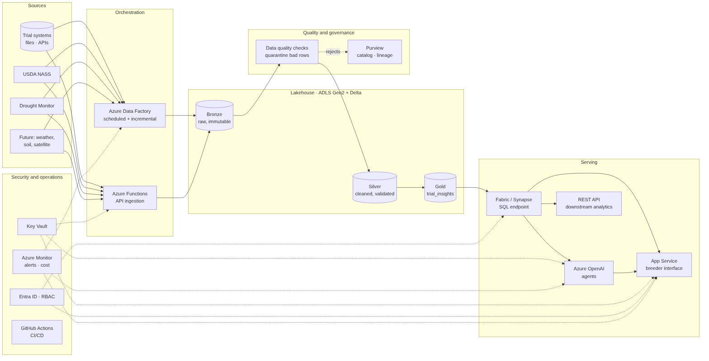

# Production scenario

Target: thousands of trial locations, multiple seasons, recurring ingestion of USDA and weather data, more environmental datasets, and downstream analytics and AI applications. The prototype already has the right shape (raw cache → clean tables → one curated view → UI and agent); production replaces each piece with a managed, governed equivalent on Azure.

## Target architecture

| Concern | Prototype | Production (Azure) |
|---|---|---|
| Orchestration | Manual run / GitHub Actions | Azure Data Factory (or Fabric Data Pipelines) schedules; Azure Functions for API ingestion |
| Storage | Parquet + DuckDB file | ADLS Gen2 with Delta Lake, medallion layers (bronze / silver / gold) |
| Compute | Single Python process | Databricks or Fabric Spark for transforms; same Python logic packaged as a library |
| Serving | DuckDB view | Fabric / Synapse SQL endpoint over gold Delta tables; REST API for other systems |
| Interface | Streamlit Community Cloud | Azure App Service or Container Apps, private network, Entra ID sign-in |
| LLM | Gemini free tier | Azure OpenAI in the company tenant (data stays in the tenant) |
| Secrets | `.env` / platform secrets | Azure Key Vault, managed identities |
| CI/CD | GitHub Actions tests | GitHub Actions: tests, infrastructure as code (Bicep/Terraform), staged deploys |

## Orchestration and incremental processing
- **Trials:** ingest from the trial management system on change (event or daily), keyed by trial id + season; upsert into silver with Delta `MERGE`.
- **NASS:** weekly job after the Monday Crop Progress release; only the current season is reloaded, previous seasons are frozen.
- **Drought Monitor:** weekly job after the Thursday release; request only new weeks per county (`startdate` = last loaded week).
- **Geocoding:** only for new or changed coordinates; results cached in a dimension table.
- **Gold:** recompute only trials whose inputs changed; partition by season and region.
- Every job is idempotent (re-running a week gives the same result), so retries and backfills are safe.

## Data quality
- Today's flags become **data contracts** checked at the bronze → silver boundary (e.g. Great Expectations or Delta constraints): valid zone, coordinates inside a county, harvest after planting, unique trial id.
- Bad rows go to a **quarantine table** with the reason, and the owning team is notified; they never disappear silently.
- External data checks: NASS weeks inside the season and monotonic %, Drought Monitor percentages between 0 and 100 and cumulative (D0 ≥ D1 ≥ …). The North Dakota issue found in the backtest is exactly the kind of check that should run automatically.
- Freshness checks: alert if NASS or USDM has not updated when expected.

## Monitoring and reliability
- Azure Monitor / Log Analytics: job duration, row counts per layer, API errors, rejected rows.
- Alerts on failed runs, stale sources and quality thresholds.
- Retries with backoff (already in the clients), dead-letter for persistent failures, and the raw cache allows replay without calling the APIs again.
- **Agent monitoring:** log question, generated SQL, rows returned, latency, model and user feedback; track the share of refused or failed questions.

## Lineage and governance
- Microsoft Purview catalogs every table and its lineage from source API to gold view.
- Each gold row carries the run id, source versions (NASS week, USDM map date) and method version, the production equivalent of "How I got this result".
- Assumptions (70-day pollination, 50% threshold, timing bands) live in versioned configuration, so changing one is reviewed and traceable.

## Security
- Entra ID sign-in and role-based access (breeders read gold; engineers manage silver/bronze).
- Private endpoints for storage, SQL and Azure OpenAI; no public data endpoints.
- The agent keeps the prototype's guardrails: read-only identity, allowed tables only, no file or network access from SQL, row limits; plus row-level security so a breeder only sees permitted programs.
- Secrets in Key Vault, accessed with managed identities; no keys in code or CI logs.

## Storage optimization and cost
- Delta with partitioning by season/region, Z-ordering on trial id and date, periodic `OPTIMIZE`/`VACUUM`.
- Bronze kept in cool storage after a retention period.
- Weekly external data is small; most cost is compute and LLM. Use serverless or auto-terminating clusters, and job clusters instead of always-on ones.
- LLM: small/fast model for SQL generation, cache answers to frequent questions, per-user quotas, budget alerts.

## Downstream analytics and AI
- Gold tables become the shared source for Power BI reports, trial planning and harvest logistics.
- A **semantic layer** (documented columns, units, business definitions) feeds both BI and the agent, so the agent's schema prompt is generated, not hand-written.
- **Agent evaluation:** a set of reference questions with expected SQL/results runs in CI on every prompt or model change (LLMOps), with accuracy tracked over time.
- New datasets (weather, soil, satellite) join by county/date or field geometry and extend the same view.

## Integration with GDM workflows
- **Harvest planning:** a weekly list of trials expected to be ready in the next 2 weeks, sent to field teams (Teams/e-mail) and exposed in the planning tool.
- **Data stewardship:** trials flagged `overdue_verify_record` or with quality flags generate a task to update the record in the trial system.
- **Trial analysis:** drought-at-pollination becomes a covariate when breeders compare hybrids, so stressed sites are interpreted or excluded consistently.
- **Season review:** harvest timing vs the area by region feeds next season's site and maturity selection.
